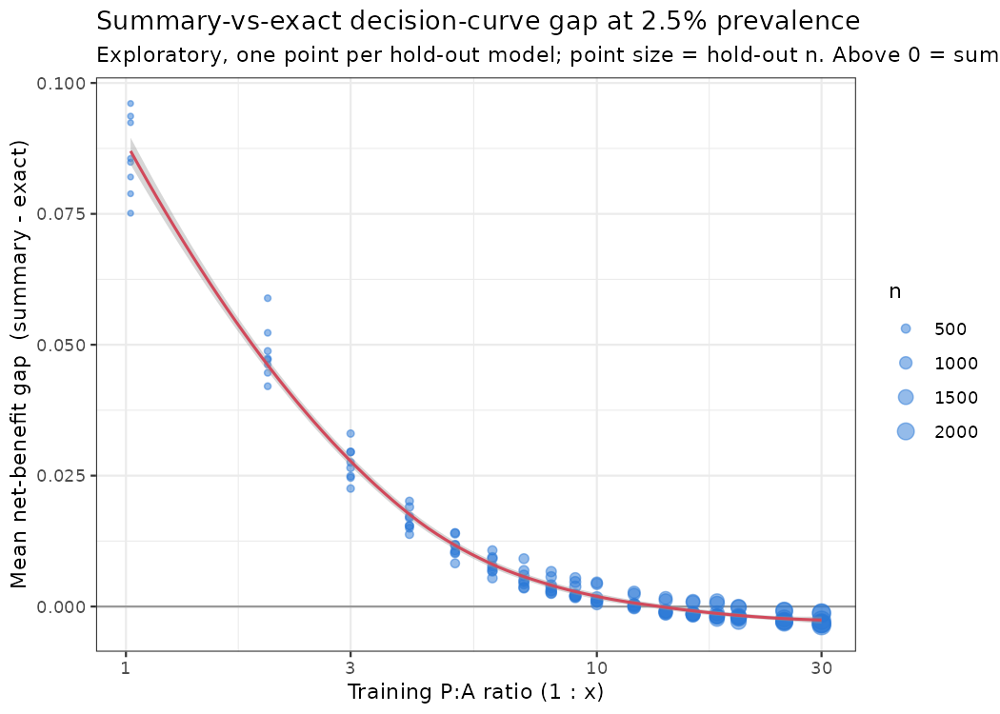
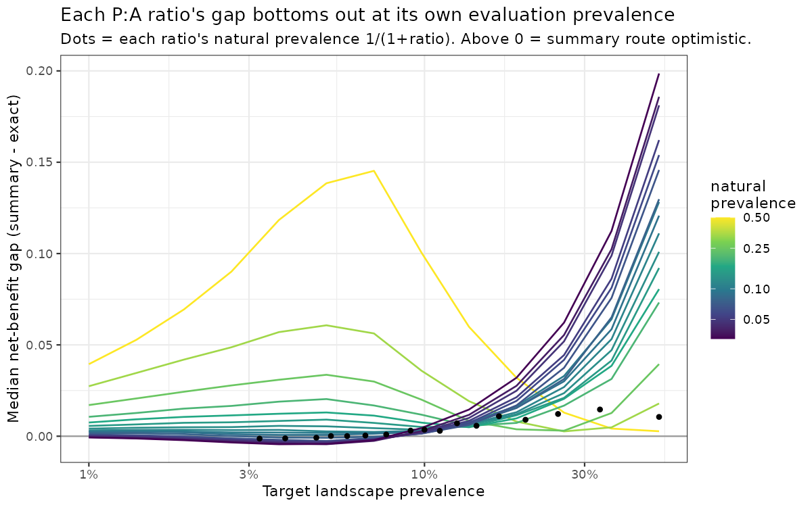

**Question.** The summary route (reconstruct a decision curve from a model's reported PR-AUC via a binormal ROC) is cheap but assumes a curve shape; the per-point route (reweight the held-out predictions to the target prevalence) is exact but needs the raw predictions. When do they agree?

**Experiment.** For 128 spatial-mapping SDMs of *E. coloradense* spanning presence:absence design ratios from 1:1 to 1:30, we computed both decision curves at a target landscape prevalence and recorded their difference, `gap = net benefit (summary) − net benefit (exact)`, averaged over a prevalence-relative threshold window. We then (i) held the target at 2.5% and varied the P:A ratio, and (ii) swept the target prevalence from 1% to 50%. Each model's binormal was anchored to its own reported PR-AUC at its evaluation prevalence; the gap is a median across replicate seeds.

**Result.** The gap is governed by the distance between a model's *evaluation* prevalence (set by its P:A ratio, natural prevalence $1/(1+\text{ratio})$) and the *target* prevalence — not by the model's calibration (hold-out cox intercept is unrelated, Spearman $\approx 0.17$).

{#fig-gap-ratio}

{#fig-gap-target}

**Implication.** Use the summary route when a model's reported P:A ratio sits near the landscape prevalence of interest; otherwise the reported number is being read at the wrong prevalence, and the per-point route is worth the extra data. This is a property of *where the model was scored*, not of how good it is.
